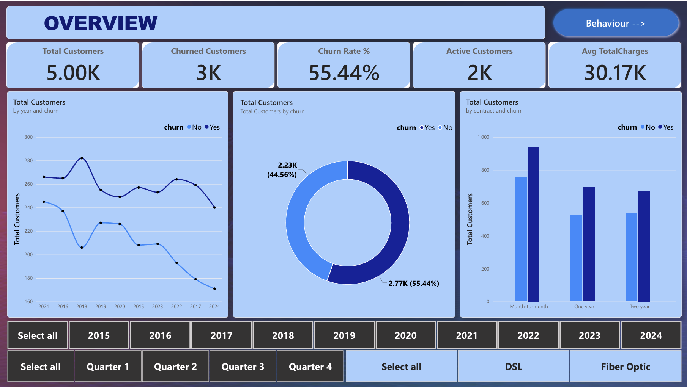
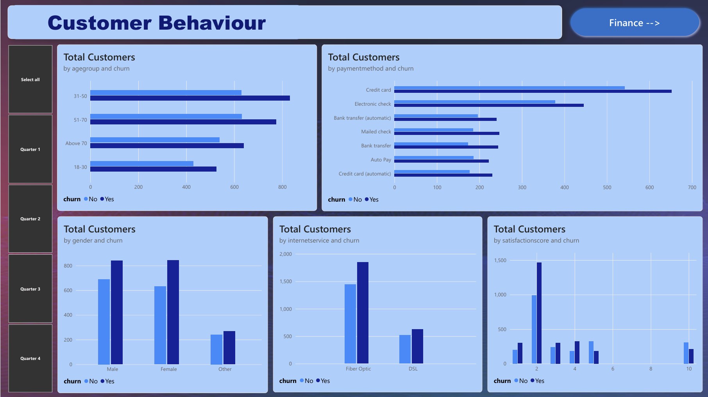
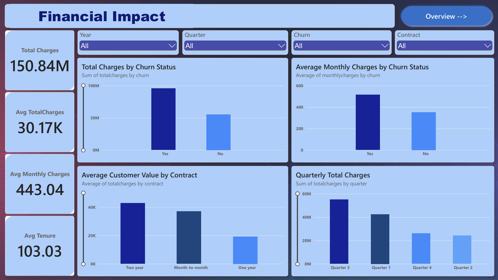

# Customer Churn Analysis and Retention Dashboard

## Project Overview

This project focuses on preparing and analyzing customer data to understand churn patterns and support data-driven customer-retention decisions. It includes an original messy dataset and a cleaned dataset prepared for further analysis.

The project is designed to demonstrate a practical data-analytics workflow: data inspection, data cleaning, feature preparation, exploratory analysis, SQL analysis, and dashboard reporting.

## Dataset

Two dataset files are part of the project:

| File | Description | Records | Columns |
|---|---|---:|---:|
| `Customer_Churn_Messy_Data.csv` | Original dataset containing inconsistent and messy values | 5,280 | 22 |
| `Customer_Churn_Cleaned_Data.csv` | Processed dataset with standardized column names and additional analysis fields | 5,000 | 25 |

### Main fields

The datasets contain customer and service-related fields such as:

- Customer attributes: age, gender, state, partner, dependents, and senior-citizen status
- Account details: signup date, tenure, contract, and paperless billing
- Service and payment details: internet service, payment method, monthly charges, and total charges
- Customer experience: number of support calls and satisfaction score
- Target field: churn status

The cleaned dataset also includes derived fields such as `agegroup`, `year`, `month`, and `quarter`.

> **Privacy and licensing:** Check the dataset's original source and license before publishing it. The supplied CSV files contain names, phone numbers, and email addresses. Do not upload these files to a public repository in their current form. Use an appropriately anonymized version or provide a link to the permitted source dataset instead.

## Project Objectives

- Inspect the structure and quality of the original dataset.
- Identify and address missing, inconsistent, invalid, and incorrectly formatted values.
- Standardize column names and categorical values for analysis.
- Prepare customer and account attributes for exploratory analysis.
- Analyze churn patterns across tenure, contract, payment method, service type, customer characteristics, and spending.
- Present findings in a clear, business-focused report or dashboard.
- Recommend customer-retention actions based on verified results.

## Tools and Technologies

Update this list to include only the tools actually used in your project.

- **Python** — data inspection, cleaning, and exploratory data analysis
- **Pandas / NumPy** — data manipulation and preparation
- **Matplotlib / Seaborn** — charts and visual analysis, if used
- **PostgreSQL** — SQL-based analysis, if used
- **Power BI** — dashboarding and KPI reporting, if used

## Data Preparation Workflow

1. Load and inspect the original CSV.
2. Review row counts, columns, data types, missing values, and inconsistent entries.
3. Clean and standardize relevant fields.
4. Convert numerical and categorical columns to suitable data types.
5. Create derived fields such as age groups and signup date components where valid.
6. Validate the cleaned output and save the processed dataset.
7. Use the cleaned data for analysis and reporting.

Document the exact cleaning decisions in your notebook or report. The cleaned file should still be validated before analysis: it currently includes `Unknown` values and `00-00-0000` signup-date placeholders, so do not assume every field is fully resolved.

## Repository Structure

A suggested structure for this GitHub repository is:

```text
customer-churn-analysis/
├── data/
│   ├── Customer_Churn_Messy_Data.csv
│   └── Customer_Churn_Cleaned_Data.csv                
├── notebooks/
│   └── data_cleaning.ipynb
├── sql/
│   └── churn_analysis.sql
├── dashboard/
│   ├── Customer_Churn_Analysis.pbix
│   └── screenshots/
│       ├── overview.png
│       ├── customer-behaviour.png
│       └── financial-impact.png
├── README.md
└── .gitignore
```

Include only files that you have actually created. If you publish the datasets, use a privacy-safe, license-compliant version. Otherwise, document how to obtain the dataset from its original source.

## Analysis Areas

Possible analysis areas, depending on the work completed, include:

- Overall churn and retention rates
- Churn by tenure and contract type
- Churn by payment method and internet-service type
- Churn by age group and other customer characteristics
- Monthly charges and total charges by churn status
- Support-call frequency and satisfaction-score patterns

## Dashboard





Remove any image line for a screenshot you do not have, and ensure the file names match your repository.

## Key Findings

Add verified results from your analysis here. Examples of what to report:

- Overall churn rate and number of churned customers
- Customer segments with comparatively higher churn
- Relationships between contract type, tenure, charges, support calls, and churn
- Findings that can be translated into customer-retention actions

Do not add percentages or conclusions until they have been calculated and checked against the cleaned dataset.

## Business Recommendations

Base recommendations on your actual findings. Potential actions to evaluate include:

- Review onboarding and support for customer groups with higher churn.
- Investigate whether contract type or payment experience is associated with churn.
- Monitor satisfaction and support-call patterns alongside churn.
- Track churn and retention KPIs over time to assess whether interventions help.

These are analysis prompts, not conclusions; include only recommendations supported by your results.

## How to Reproduce the Analysis

1. Obtain the dataset from its permitted source and place the privacy-safe file in the expected `data/` folder.
2. Open the notebook in Jupyter Notebook or VS Code.
3. Install the libraries imported in the notebook.
4. Update the dataset path to match your local folder.
5. Run the notebook cells in order.
6. If SQL is included, load the relevant tables into PostgreSQL and run the documented queries.
7. If a Power BI report is included, open the `.pbix` file in Power BI Desktop and update its data source path if required.

Add a `requirements.txt` file if you want to document the exact Python dependencies.

## Limitations

- Results depend on the quality, scope, and licensing of the dataset used.
- Invalid or unknown values may affect analysis if they are not handled consistently.
- Associations between customer attributes and churn do not by themselves establish causation.
- Remove or anonymize personal information before publishing project data.

## Author

**Ashok Kumar Jena**

Data Analyst Portfolio Project
